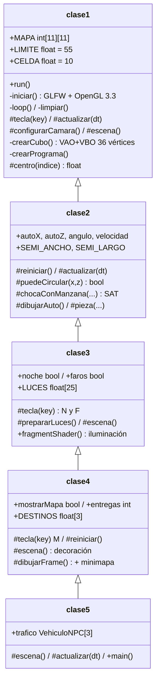
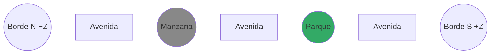
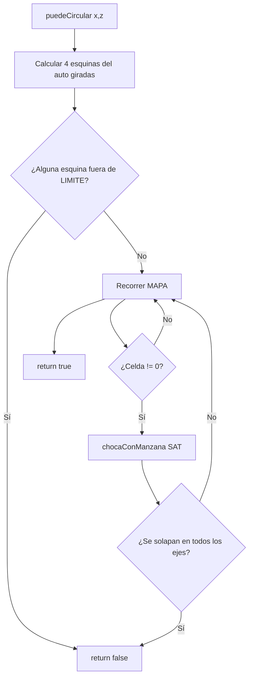
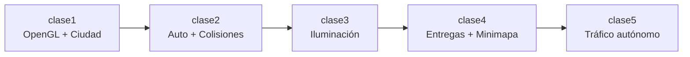
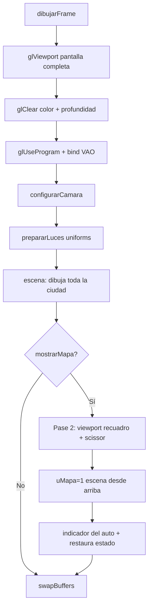
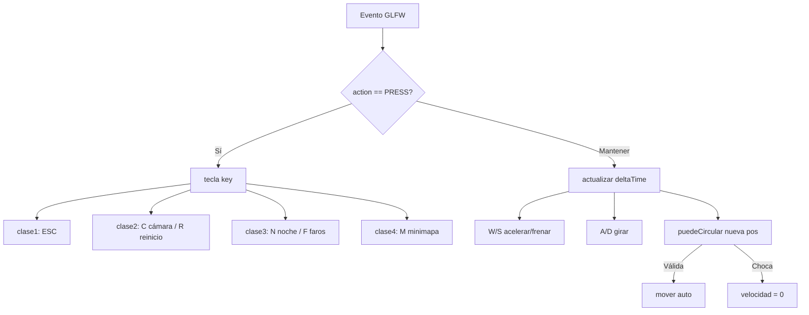

# Ciudad Interactiva con OpenGL — Documentación del Proyecto

**Asignatura:** Programación Gráfica
**Autor:** JoseC
**Stack:** Java 17 · Maven · LWJGL 3.3.3 · OpenGL 3.3 Core · GLSL 330

> Documento de entrega del proyecto *“Ciudad y conducción por etapas”*, ampliado hasta
> cumplir el enunciado de la actividad práctica. Todo el contenido descrito corresponde al
> código fuente de la carpeta `CiudadConduccion/`.

## Índice

1. [Resumen y objetivos](#1-resumen-y-objetivos)
2. [Arquitectura del proyecto](#2-arquitectura-del-proyecto)
3. [Diseño de la ciudad ampliada](#3-diseño-de-la-ciudad-ampliada)
4. [Colisiones y límites de circulación](#4-colisiones-y-límites-de-circulación)
5. [Tabla de controles](#5-tabla-de-controles)
6. [Guía de iluminación](#6-guía-de-iluminación)
7. [Decoración urbana y semáforos animados](#7-decoración-urbana-y-semáforos-animados)
8. [Minimapa y su adaptación al redimensionado](#8-minimapa-y-su-adaptación-al-redimensionado)
9. [Reinicio con R y sistema de entregas](#9-reinicio-con-r-y-sistema-de-entregas)
10. [Movimiento independiente de los FPS](#10-movimiento-independiente-de-los-fps-delta-time)
11. [Organización por responsabilidades](#11-organización-del-proyecto-por-responsabilidades)
12. [Estructura de carpetas y archivos](#12-estructura-de-carpetas-y-archivos)
13. [Ejemplo de pom.xml](#13-ejemplo-de-pomxml)
14. [Fragmentos de código relevantes](#14-fragmentos-de-código-relevantes)
15. [Mejoras opcionales](#15-mejoras-opcionales-bonificación)
16. [Criterios de evaluación](#16-criterios-de-evaluación-y-cómo-se-cumplen)
17. [Demostración y verificación](#17-demostración-y-verificación)
18. [Recursos externos y limitaciones](#18-recursos-externos-y-limitaciones)
19. [Instrucciones de ejecución](#19-instrucciones-de-ejecución)
20. [Preguntas frecuentes](#20-preguntas-frecuentes)
21. [Checklist final de entregables](#21-checklist-final-de-entregables)

---

## 1. Resumen y objetivos

### 1.1 Objetivo general

El proyecto amplía una ciudad 3D interactiva construida con **OpenGL** mediante **LWJGL**
sobre **Java + Maven**, partiendo de una matriz de 7 × 7 celdas. La ampliación crece el mapa
a **11 × 11**, incorpora **iluminación ambiental, direccional, farolas y faros**,
**decoración urbana** (árboles, bancos, ventanas, pasos peatonales y semáforos animados), un
**minimapa** con vista superior, un **sistema de entregas** con reinicio y una **bonificación
de tráfico autónomo**.

### 1.2 Qué se evalúa

| Aspecto evaluado | Dónde se resuelve |
|---|---|
| Ampliación del mapa y red vial | `clase1.MAPA` (11 × 11) |
| Límites y colisiones | `clase1.LIMITE/CELDA`, `clase2.puedeCircular()` |
| Conducción acumulativa | Herencia `clase1 → … → clase5` |
| Iluminación | `clase3` (fragment shader + `LUCES`) |
| Decoración y semáforos | `clase4.decorarCiudad()` |
| Minimapa y destino | `clase4.dibujarFrame()` (2º pase) |
| Reinicio | `clase2.reiniciar()` + `clase4` |
| Tráfico autónomo (bonificación) | `clase5` (`VehiculoNPC[]`) |

### 1.3 Pregunta 1 — Objetivo y evaluación

El objetivo es **demostrar el dominio del pipeline de OpenGL moderno** (shaders, VAO/VBO,
matrices de vista y proyección, iluminación por fragmentos) construyendo una escena 3D
coherente y **jugable**. Se evalúa la corrección técnica, la **coherencia del escenario al
ampliar** (que límites, colisiones, cámara y minimapa se adapten, no solo el dibujo), la
**organización por responsabilidad** y la **demostración en vivo**. El 50 % de la nota
obligatoria proviene de la **explicación técnica durante la clase**, por lo que este
documento sirve también de guion.

---

## 2. Arquitectura del proyecto

El diseño usa **herencia acumulativa**: cada etapa extiende la anterior y **amplía** su
comportamiento con `@Override` + `super`, sin duplicar la configuración de OpenGL.

### 2.1 Diagrama de arquitectura de clases



### 2.2 Pregunta 18 — Organización por responsabilidades

- **`clase1`** — Infraestructura + ciudad: ventana GLFW, contexto OpenGL 3.3, shaders,
  cubo (VAO/VBO), cámara orbital y ciudad desde `MAPA`.
- **`clase2`** — Conducción: estado del auto, aceleración/frenado, giro, colisiones y
  cámara de seguimiento.
- **`clase3`** — Iluminación: sol, ambiente, farolas y faros (cálculo en el fragment shader).
- **`clase4`** — Funciones adicionales: entregas, decoración, semáforos y minimapa.
- **`clase5`** — Bonificación: tráfico autónomo de NPCs.

Cada clase tiene su propio `main`, de modo que puede ejecutarse como **etapa independiente**.

---

## 3. Diseño de la ciudad ampliada

### 3.1 Pregunta 2 — Ampliar de 7 × 7 a 11 × 11 conservando la celda

La ciudad se genera desde una matriz `MAPA` (`0 = calle`, `1 = edificio`, `2 = parque`). El
tamaño de celda (`CELDA = 10`) y el centro (`LIMITE = 55`) se mantienen; solo cambia la
cantidad de filas y columnas (de 7 a 11). El bucle de `escena()` recorre `MAPA.length`,
así que la ciudad crece sola.

```java
protected static final float LIMITE = 55;   // Origen a cada borde: mapa de 110 unidades.
protected static final float CELDA  = 10;   // Ancho y profundidad de cada celda.
protected static final int[][] MAPA = {
    {0, 0, 0, 0, 0, 0, 0, 0, 0, 0, 0}, // Fila norte: calle continua.
    {0, 1, 0, 1, 0, 2, 0, 1, 0, 1, 0}, // Manzanas y un parque.
    {0, 0, 0, 0, 0, 0, 0, 0, 0, 0, 0}, // Avenida horizontal.
    {0, 2, 0, 1, 0, 1, 0, 1, 0, 1, 0}, // Fila central de manzanas.
    {0, 0, 0, 0, 0, 0, 0, 0, 0, 0, 0}, // Avenida horizontal.
    {0, 1, 0, 2, 0, 1, 0, 1, 0, 1, 0}, // Última fila de manzanas.
    {0, 0, 0, 0, 0, 0, 0, 0, 0, 0, 0}, // Calle del borde sur.
    {0, 1, 0, 1, 0, 2, 0, 1, 0, 2, 0}, // Manzanas inferiores + parques.
    {0, 0, 0, 0, 0, 0, 0, 0, 0, 0, 0}, // Avenida horizontal.
    {0, 2, 0, 1, 0, 1, 0, 1, 0, 1, 0}, // Fila central inferior.
    {0, 0, 0, 0, 0, 0, 0, 0, 0, 0, 0}  // Calle del borde sur.
};
```

La conversión de índice a coordenada se mantiene intacta:

```java
protected static float centro(int indice) {
    return -LIMITE + CELDA * (indice + 0.5f); // Borde negativo + avance a media celda.
}
```

Con `indice` de `0` a `10`, `centro()` devuelve de `-50` a `+50`, cada `10` unidades sobre
el asfalto de `110 × 110`.

### 3.2 Pregunta 3 — Red vial conectada y accesible

El patrón alterna **filas/columnas pares = calle** e **impares = manzana**. Esto garantiza
por construcción que toda manzana quede **rodeada de calles** y que avenidas y calles formen
una **malla conexa**. Todos los `DESTINOS` caen sobre celdas de calle `0`, por lo que son
alcanzables conduciendo.



### 3.3 Pregunta 4 — 12+ manzanas y 4+ parques con variación

El mapa contiene **19 manzanas con edificio** y **6 parques** (supera los mínimos de 12 y
4). La variedad se logra con fórmulas reproducibles en `clase1.escena()`:

```java
float altura = 5 + (fila * 3 + columna * 7) % 9;   // Altura entre 5 y 13.
float rojo   = 0.28f + columna * 0.045f;           // Tono según columna.
float azul   = 0.48f + fila * 0.025f;              // Tono según fila.
caja(x, altura / 2 + 0.3f, z, 7, altura, 7, rojo, 0.40f, azul); // Cuerpo.
caja(x, altura + 0.45f,   z, 7.3f, 0.3f, 7.3f, 0.20f, 0.26f, 0.32f); // Cubierta.
```

Cada celda no-calle dibuja una **acera elevada** de `10 × 10` y luego el edificio (`7 × 7`)
o el **césped** del parque (`9 × 9`), manteniendo escala coherente.

---

## 4. Colisiones y límites de circulación

### 4.1 Pregunta 5 — Adaptación de suelo, límites, colisiones, cámara y minimapa

Al ampliar la ciudad, todos los componentes dependientes del tamaño del mapa se derivan de
las constantes `LIMITE` y `CELDA`, nunca de números fijos:

| Componente | Código | Cómo se adapta |
|---|---|---|
| Suelo (asfalto) | `caja(0,-0.25f,0,110,0.5f,110,…)` | `110 = 2 × LIMITE` |
| Límite de circulación | `Math.abs(esquina) > LIMITE` | Usa `LIMITE` en cada esquina |
| Colisión con manzana | `chocaConManzana()` con `semiManzana = CELDA/2` | Usa `CELDA` |
| Cámara orbital | `sin/cos(orbita) * 65` | Radio 65 cubre el borde 55 |
| Cámara de seguimiento | `autoX ± sin(angulo)*12` | Sigue al auto |
| Minimapa (escala) | `vMundo.x / 57.0` en el shader | `57` abarca `LIMITE + margen` |

### 4.2 Análisis: caja orientada (OBB) vs. manzana (AABB)

La colisión usa el **teorema del eje de separación (SAT)**. El auto es un **rectángulo
girado** (OBB) y cada manzana un **cuadrado alineado** (AABB). Dos cajas **no** chocan si
existe algún eje donde sus proyecciones estén separadas.



Implementación real en `clase2.java`:

```java
protected static final float SEMI_ANCHO = 0.825f; // Mitad del ancho real del auto (1.65).
protected static final float SEMI_LARGO = 1.30f;  // Mitad del largo real del auto (2.6).

protected boolean puedeCircular(float x, float z) {
    float coseno = (float) Math.cos(angulo);
    float seno   = (float) Math.sin(angulo);
    float[] esquinaX = new float[4];
    float[] esquinaZ = new float[4];
    float[][] locales = { {-SEMI_ANCHO,-SEMI_LARGO}, {SEMI_ANCHO,-SEMI_LARGO},
                          {SEMI_ANCHO,SEMI_LARGO}, {-SEMI_ANCHO,SEMI_LARGO} };
    for (int i = 0; i < 4; i++) {                 // Gira cada esquina local al mundo.
        esquinaX[i] = x + coseno * locales[i][0] + seno * locales[i][1];
        esquinaZ[i] = z - seno * locales[i][0] + coseno * locales[i][1];
        if (Math.abs(esquinaX[i]) > LIMITE || Math.abs(esquinaZ[i]) > LIMITE) {
            return false;                          // Una esquina salió del asfalto.
        }
    }
    for (int fila = 0; fila < MAPA.length; fila++)
        for (int columna = 0; columna < MAPA[fila].length; columna++) {
            if (MAPA[fila][columna] == 0) continue;                 // Calle: no es obstáculo.
            if (chocaConManzana(x, z, centro(columna), centro(fila)))
                return false;                                       // El rectángulo toca la manzana.
        }
    return true;                                                     // Posición libre.
}

private boolean chocaConManzana(float x, float z, float centroX, float centroZ) {
    float coseno = (float) Math.cos(angulo);
    float seno   = (float) Math.sin(angulo);
    float semiManzana = CELDA / 2;                                   // Semi-lado de la manzana (5).
    float diferenciaX = x - centroX, diferenciaZ = z - centroZ;
    float eje1Auto = SEMI_ANCHO * Math.abs(coseno) + SEMI_LARGO * Math.abs(seno);
    if (Math.abs(diferenciaX) > eje1Auto + semiManzana) return false; // Eje X del mundo.
    float eje2Auto = SEMI_ANCHO * Math.abs(seno) + SEMI_LARGO * Math.abs(coseno);
    if (Math.abs(diferenciaZ) > eje2Auto + semiManzana) return false; // Eje Z del mundo.
    float eje3Manzana = semiManzana * (Math.abs(coseno) + Math.abs(seno));
    float proyeccion3 = diferenciaX * coseno - diferenciaZ * seno;
    if (Math.abs(proyeccion3) > SEMI_ANCHO + eje3Manzana) return false; // Eje ancho del auto.
    float eje4Manzana = semiManzana * (Math.abs(seno) + Math.abs(coseno));
    float proyeccion4 = diferenciaX * seno + diferenciaZ * coseno;
    if (Math.abs(proyeccion4) > SEMI_LARGO + eje4Manzana) return false; // Eje largo del auto.
    return true;                                                        // Sin separación: choca.
}
```

> **Por qué SAT y no un círculo:** con un círculo, al girar pegado a una pared las
> **esquinas** del rectángulo se metían en el edificio aunque el centro estuviera lejos. La
> caja orientada detiene el auto justo cuando una esquina roza la acera, sin atravesarla.

---

## 5. Tabla de controles

| Tecla | Acción | Desde la clase |
|---|---|---|
| `←` / `→` | Orbitar la ciudad (vista aérea) | `clase1` |
| `W` / `↑` | Acelerar | `clase2` |
| `S` / `↓` | Frenar y reversa | `clase2` |
| `A` / `D` | Girar (conduciendo) | `clase2` |
| `Espacio` | Freno de mano | `clase2` |
| `C` | Cámara seguimiento / aérea oblicua | `clase2` |
| `R` | Reiniciar auto y entregas | `clase2` / `clase4` |
| `N` | Día / noche | `clase3` |
| `F` | Encender / apagar faros | `clase3` |
| `M` | Mostrar / ocultar minimapa | `clase4` |
| `ESC` | Salir | `clase1` |

El **título de la ventana** funciona como indicador legible y actualizado (velocidad en
km/h, luces, entregas y tiempo), cumpliendo el requisito de información sin una GUI.

---

## 6. Guía de iluminación

Toda la iluminación se calcula **por fragmento** en el *fragment shader* de `clase3`. La
GPU recibe posiciones y estados mediante *uniforms*.

### 6.1 Pregunta 6 — Día/noche con la tecla N (ambiente + direccional)

La tecla `N` conmuta el booleano `noche`, que se envía al shader como `uNoche`. El shader
combina **luz ambiental** (igual en todas las caras) y **direccional** (tipo sol, con
Lambert sobre la normal):

```glsl
vec3 luz = vec3(0.48);          // Luz ambiental diurna.
float intensidadSol = 0.65;     // Fuerza del sol de día.
if (uNoche == 1) {              // Ambiente nocturno tenue y azulado.
    luz = vec3(0.12, 0.16, 0.24);
    intensidadSol = 0.10;
}
vec3 direccionSol = normalize(vec3(0.4, 1.0, 0.3));
float incidenciaSol = max(dot(normal, direccionSol), 0.0);   // Lambert.
luz += vec3(intensidadSol) * incidenciaSol;                  // Aporta la dirección.
```

### 6.2 Pregunta 7 — Farolas con atenuación por distancia

Se definen **25 farolas** (supera el mínimo de 9) en `clase3.LUCES`, distribuidas por toda
la malla. Cada una aporta luz con **atenuación cuadrática** y término lineal:

```glsl
if (uNoche == 1) {
    for (int indice = 0; indice < 25; indice++) {
        vec3 haciaLuz  = uLuces[indice] - vMundo;
        float distancia = length(haciaLuz);
        float difusa = max(dot(normal, normalize(haciaLuz)), 0.0);
        float atenuacion = 1.0 + 0.12 * distancia + 0.045 * distancia * distancia;
        vec3 colorFarola = vec3(1.0, 0.73, 0.34);        // Tono cálido.
        luz += colorFarola * difusa * 3.0 / atenuacion;  // Aporte atenuado.
    }
}
```

El modelo visible de la farola se dibuja en `clase3.escena()` (poste + bombilla) usando las
**mismas posiciones** que recibe el shader, de modo que la luz cae sobre suelo y edificios.

### 6.3 Pregunta 8 — Faros delanteros que siguen al auto (tecla F)

La tecla `F` conmuta `faros`. Cada cuadro `prepararLuces()` envía la posición (`uAuto`) y la
dirección (`uFrente`) del vehículo; el shader proyecta **dos conos** hacia delante:

```glsl
if (uFaros == 1) {
    for (int indice = 0; indice < 2; indice++) {
        vec3 lateral = vec3(-uFrente.z, 0.0, uFrente.x);       // Lado derecho del auto.
        float separacion = (indice == 1) ? 0.55 : -0.55;       // Faro izq/der.
        vec3 origen = uAuto + uFrente * 1.36 + lateral * separacion;
        vec3 haciaSuperficie = vMundo - origen;
        float distancia = length(haciaSuperficie);
        vec3 eje = normalize(uFrente + vec3(0.0, -0.10, 0.0)); // Ligera inclinación.
        float alineacion = dot(normalize(haciaSuperficie), eje);
        float cono = smoothstep(0.85, 0.97, alineacion);       // Borde suave del haz.
        float difusa = max(dot(normal, -normalize(haciaSuperficie)), 0.0);
        float atenuacion = 1.0 + 0.04 * distancia * distancia; // Alcance limitado.
        luz += vec3(1.0, 0.94, 0.72) * cono * difusa * 8.0 / atenuacion;
    }
}
```

### 6.4 Pregunta 9 — Luz difusa con normales y emisión de bombilla

- **Normales:** cada vértice trae su normal (`aNormal`). El *vertex shader* la transforma
  con la matriz de rotación y escala para obtener `vNormal`, que llega interpolada al
  *fragment shader*. La componente difusa es `max(dot(normal, dirLuz), 0)`.
- **Emisión vs. aporte:** el uniform `uEmision` distingue ambos casos. Cuando vale `1`, el
  objeto (bombilla, ventana encendida, semáforo activo, destino) **conserva su color** sin
  recibir iluminación; cuando vale `0`, se calcula la luz sobre la superficie:

```glsl
if (uEmision == 1 || uMapa == 1) {
    color = vec4(uColor, 1.0);   // Emisión: color directo (no se oscurece).
    return;
}
// ... cálculo de luz difusa sobre la superficie ...
color = vec4(uColor * luz, 1.0); // Material × luz acumulada.
```

> Esto satisface el requisito de **diferenciar la emisión visual de la bombilla** del
> **aporte de luz** que entrega al entorno.

---

## 7. Decoración urbana y semáforos animados

### 7.1 Pregunta 10 — Árboles, bancos, ventanas y pasos peatonales

`clase4.decorarCiudad()` recorre el mapa y, según el tipo de parcela, añade elementos
**compuestos por cajas** (manteniendo la escala de la celda):

| Elemento | Método | Escala |
|---|---|---|
| Árboles (4 por parque) + banco | `dibujarParque()` | tronco 0.35, copa 2.0 |
| Ventanas en 4 fachadas | `dibujarVentanas()` | 0.8 × 0.9 por piso |
| Paso peatonal (7 franjas) | `dibujarPasoPeatonal()` | franjas de 0.45 |
| Semáforo | `dibujarSemaforo()` | poste + carcasa de 3 luces |

```java
private void dibujarParque(float x, float z) {
    float[] posiciones = {-2.5f, 2.5f};            // 4 árboles por parcela.
    for (float dx : posiciones) for (float dz : posiciones) {
        caja(x+dx, 1.2f, z+dz, 0.35f, 2, 0.35f, 0.38f, 0.22f, 0.12f); // Tronco.
        caja(x+dx, 2.7f, z+dz, 2, 2.3f, 2, 0.12f, 0.42f, 0.23f);       // Copa.
    }
    caja(x, 0.65f, z, 3, 0.25f, 0.8f, 0.55f, 0.30f, 0.13f);            // Asiento.
    caja(x, 0.4f,  z, 2, 0.6f, 0.35f, 0.22f, 0.24f, 0.24f);            // Soporte.
    caja(x, 1, z + 0.35f, 3, 0.7f, 0.15f, 0.55f, 0.30f, 0.13f);        // Respaldo.
}
```

### 7.2 Pregunta 11 — Ventanas iluminadas de noche

Las ventanas se dibujan con `uEmision = 1` **solo cuando `noche` es verdadero**, así
parecen habitaciones encendidas sin depender de las farolas:

```java
private void dibujarVentanas(float x, float z, float altura) {
    if (noche) { entero("uEmision", 1); }          // Enciende ventanas de noche.
    for (float y = 1.7f; y < altura; y += 2) {     // Un piso cada 2 unidades.
        for (float d = -2; d <= 2; d += 2) {       // Tres ventanas por fachada.
            caja(x + d, y, z - 3.51f, 0.8f, 0.9f, 0.04f, 0.95f, 0.75f, 0.38f);
            caja(x + d, y, z + 3.51f, 0.8f, 0.9f, 0.04f, 0.95f, 0.75f, 0.38f);
            caja(x - 3.51f, y, z + d, 0.04f, 0.9f, 0.8f, 0.95f, 0.75f, 0.38f);
            caja(x + 3.51f, y, z + d, 0.04f, 0.9f, 0.8f, 0.95f, 0.75f, 0.38f);
        }
    }
    entero("uEmision", 0);                          // Restaura iluminación normal.
}
```

### 7.3 Pregunta 12 — Semáforos animados por tiempo (rojo → verde → amarillo)

El semáforo usa `tiempo % 12` para ciclar la fase; la bombilla activa se marca con
`uEmision = 1` y las demás con brillo tenue. **El alcance es visual** (no detiene al auto):

```java
int fase = (int) (tiempo % 12);          // Ciclo de 12 s.
// rojo: fase < 5  ·  verde: 5 ≤ fase < 10  ·  amarillo: fase ≥ 10
float brillo = encendida ? 1 : 0.15f;
entero("uEmision", encendida ? 1 : 0);
caja(x, altura, z - 0.24f, 0.28f, 0.25f, 0.06f, rojo, verde, 0.02f);
```

---

## 8. Minimapa y su adaptación al redimensionado

### 8.1 Pregunta 13 — Vista superior en una esquina

`clase4.dibujarFrame()` hace **dos pasadas**: primero la escena principal en perspectiva y
después la misma ciudad **vista desde arriba** en un recuadro. El shader cambia a una
**proyección ortográfica** cuando `uMapa == 1`, con el **norte (−Z) hacia arriba**:

```glsl
if (uMapa == 1) {
    float pantallaX = vMundo.x / 57.0;   // Ajusta el ancho al rango -1..1.
    float pantallaY = -vMundo.z / 57.0;  // Norte (-Z) arriba del mapa.
    float profundidad = -vMundo.y / 100.0;
    gl_Position = vec4(pantallaX, pantallaY, profundidad, 1.0);
}
```

La posición y orientación del auto se dibujan con `dibujarIndicadorAuto()` (rectángulo cian
girado + punta blanca al frente), y el destino activo es la **marca dorada** de `escena()`.

### 8.2 Pregunta 14 — Mostrar/ocultar con M y no alterar la vista principal

El tecla `M` conmuta `mostrarMapa`. Para no dañar la vista principal se usa **scissor
test**: el `glClear` del minimapa queda recortado a su recuadro y se dibuja por encima. El
estado se restaura siempre con `finally`:

```java
int dimensionMenor = Math.min(ancho, alto);        // Lado limitante.
int lado = Math.min(260, dimensionMenor / 3);      // Mapa cuadrado, máx 260 px.
int margen = Math.min(18, dimensionMenor / 20);
int x = ancho - lado - margen;                     // Esquina (OpenGL mide Y desde abajo).
int y = alto  - lado - margen;
glEnable(GL_SCISSOR_TEST);
glScissor(x - 3, y - 3, lado + 6, lado + 6);       // Marco exterior.
glClear(GL_COLOR_BUFFER_BIT | GL_DEPTH_BUFFER_BIT);
glScissor(x, y, lado, lado);                       // Interior del mapa.
glClear(GL_COLOR_BUFFER_BIT | GL_DEPTH_BUFFER_BIT);
glViewport(x, y, lado, lado);
entero("uMapa", 1);
vistaMapa = true;
try {
    escena();
    dibujarIndicadorAuto();
} finally {
    vistaMapa = false;
    entero("uMapa", 0);
    glDisable(GL_SCISSOR_TEST);
    glViewport(0, 0, ancho, alto);                 // Restaura pantalla completa.
}
```

### 8.3 Pregunta 15 — Encuadre al redimensionar la ventana

Cada cuadro se leen las dimensiones reales del *framebuffer* (`glfwGetFramebufferSize`) y el
tamaño/posición del minimapa se recalculan con `lado`, `margen`, `x` e `y` derivados de
`ancho`/`alto`. Así el mapa **mantiene su lugar** relativo al borde derecho-superior sin
importar el tamaño, y la proyección usa `uAspecto` para no deformarse.

---

## 9. Reinicio con R y sistema de entregas

### 9.1 Pregunta 16 — Reinicio de posición, orientación y velocidad

`clase2.reiniciar()` restaura el vehículo; `clase4` lo amplía para reiniciar también las
entregas y el cronómetro:

```java
// clase2
protected void reiniciar() {
    autoX = -30;      // Posición X inicial (centro de calle).
    autoZ = 30;       // Posición Z inicial.
    angulo = 0;       // Frente hacia -Z.
    velocidad = 0;    // Detenido.
}

// clase4
@Override
protected void reiniciar() {
    super.reiniciar();   // Restaura el auto.
    entregas = 0;        // Vuelve a la primera parada.
    tiempo = 0;          // Reinicia el cronómetro.
}
```

Esto permite **completar nuevamente toda la actividad** tras ganar (mensaje
“GANASTE … R: jugar otra vez”).

### 9.2 Regla de entrega

Una entrega se completa al acercarse a menos de **3 unidades** del destino activo y circular
a menos de **1 unidad/segundo** (hay que frenar en la marca dorada):

```java
boolean estaCerca = distanciaCuadrada < 3 * 3;
boolean estaFrenando = Math.abs(velocidad) < 1;
if (estaCerca && estaFrenando) { entregas++; }
```

---

## 10. Movimiento independiente de los FPS (delta time)

### 10.1 Pregunta 17 — Uso del tiempo entre cuadros

El bucle principal mide el tiempo real con `glfwGetTime()` y calcula `deltaTime`. Todas las
magnitudes físicas (aceleración, velocidad, giro, tiempo de partida) se integran
multiplicando por `deltaTime`, de modo que el comportamiento es **idéntico a 30 o 144 FPS**.
Se aplica un **límite de 50 ms** para evitar saltos gigantes al arrastrar la ventana:

```java
double tiempoAnterior = glfwGetTime();
while (!glfwWindowShouldClose(ventana)) {
    glfwPollEvents();
    double tiempoActual = glfwGetTime();
    float deltaTime = (float) Math.min(tiempoActual - tiempoAnterior, 0.05);
    tiempoAnterior = tiempoActual;
    actualizar(deltaTime);
    // ... dibujo y swap ...
}
```

En `clase2.actualizar()` la integración usa esa misma variable:

```java
velocidad += acelerador * 9 * deltaTime;                 // 9 u/s² de aceleración.
velocidad *= (float) Math.exp(-resistencia * deltaTime); // Resistencia proporcional.
angulo += direccion * velocidad * 0.11f * deltaTime;     // Giro según velocidad.
float siguienteX = autoX + frenteX * velocidad * deltaTime;
```

---

## 11. Organización del proyecto por responsabilidades

El paquete `com.graphics` concentra las cinco clases con una responsabilidad clara. La
separación por herencia permite que la **conducción**, la **iluminación** y las **funciones
adicionales** sean módulos independientes y reutilizables:



- **Bajo acoplamiento por estado compartido:** cada capa solo conoce sus propias variables
  (`noche`, `faros`, `entregas`, `mostrarMapa`, `trafico`).
- **Extensión sin modificación:** se usa `super.método()` para conservar el comportamiento
  previo y añadir el nuevo, sin tocar la clase base.

---

## 12. Estructura de carpetas y archivos

```text
CiudadConduccion/
├── pom.xml
├── README.md
├── docs/
│   └── ENTREGA_CiudadConduccion.md      (este documento)
├── .gitignore
└── src/
    ├── main/
    │   └── java/
    │       └── com/
    │           └── graphics/
    │               ├── clase1.java      Infraestructura + ciudad 11×11
    │               ├── clase2.java      Conducción + colisiones (SAT)
    │               ├── clase3.java      Iluminación + farolas + faros
    │               ├── clase4.java      Entregas + decoración + minimapa
    │               └── clase5.java      Tráfico autónomo (bonificación)
    └── test/
        └── java/
            └── com/
                └── graphics/
                    └── ConduccionTest.java   Pruebas de lógica (sin ventana)
```

> **No se incluyen** `target/` (compilados) ni las dependencias descargadas en `~/.m2`.
> Todo se regenera con `mvn`.

---

## 13. Ejemplo de pom.xml

El `pom.xml` declara **Java 17**, **LWJGL 3.3.3** (módulos `lwjgl`, `lwjgl-glfw`,
`lwjgl-opengl` más sus *natives*) y el plugin `exec` para ejecutar la clase principal.

Pregunta 19 — dependencias LWJGL necesarias:

```xml
<?xml version="1.0" encoding="UTF-8"?>
<project xmlns="http://maven.apache.org/POM/4.0.0"
         xmlns:xsi="http://www.w3.org/2001/XMLSchema-instance"
         xsi:schemaLocation="http://maven.apache.org/POM/4.0.0 https://maven.apache.org/xsd/maven-4.0.0.xsd">
  <modelVersion>4.0.0</modelVersion>
  <groupId>com.graphics</groupId>
  <artifactId>ciudad-conduccion</artifactId>
  <version>1.0-SNAPSHOT</version>
  <properties>
    <maven.compiler.release>17</maven.compiler.release>
    <project.build.sourceEncoding>UTF-8</project.build.sourceEncoding>
    <lwjgl.version>3.3.3</lwjgl.version>
    <mainClass>com.graphics.clase4</mainClass>
  </properties>
  <dependencies>
    <!-- Núcleo LWJGL + bindings y bibliotecas nativas por plataforma. -->
    <dependency>
      <groupId>org.lwjgl</groupId><artifactId>lwjgl</artifactId>
      <version>${lwjgl.version}</version>
    </dependency>
    <dependency>
      <groupId>org.lwjgl</groupId><artifactId>lwjgl-glfw</artifactId>
      <version>${lwjgl.version}</version>
    </dependency>
    <dependency>
      <groupId>org.lwjgl</groupId><artifactId>lwjgl-opengl</artifactId>
      <version>${lwjgl.version}</version>
    </dependency>
    <!-- natives-windows / natives-macos / natives-linux (scope runtime) -->
    <dependency>
      <groupId>org.lwjgl</groupId><artifactId>lwjgl</artifactId>
      <version>${lwjgl.version}</version>
      <classifier>natives-windows</classifier><scope>runtime</scope>
    </dependency>
    <dependency>
      <groupId>org.lwjgl</groupId><artifactId>lwjgl-glfw</artifactId>
      <version>${lwjgl.version}</version>
      <classifier>natives-windows</classifier><scope>runtime</scope>
    </dependency>
    <dependency>
      <groupId>org.lwjgl</groupId><artifactId>lwjgl-opengl</artifactId>
      <version>${lwjgl.version}</version>
      <classifier>natives-windows</classifier><scope>runtime</scope>
    </dependency>
    <dependency>
      <groupId>junit</groupId><artifactId>junit</artifactId>
      <version>3.8.1</version><scope>test</scope>
    </dependency>
  </dependencies>
  <build><plugins>
    <plugin>
      <groupId>org.apache.maven.plugins</groupId>
      <artifactId>maven-compiler-plugin</artifactId><version>3.13.0</version>
    </plugin>
    <plugin>
      <groupId>org.codehaus.mojo</groupId>
      <artifactId>exec-maven-plugin</artifactId><version>3.1.0</version>
      <configuration>
        <executable>${java.home}/bin/java</executable>
        <arguments>
          <argument>-classpath</argument><classpath/><argument>${mainClass}</argument>
        </arguments>
      </configuration>
    </plugin>
  </plugins></build>
  <!-- Perfil macos: GLFW exige -XstartOnFirstThread en el primer hilo. -->
  <profiles>
    <profile><id>macos</id>
      <activation><os><family>mac</family></os></activation>
      <build><plugins><plugin>
        <groupId>org.codehaus.mojo</groupId><artifactId>exec-maven-plugin</artifactId>
        <configuration><arguments combine.self="override">
          <argument>-XstartOnFirstThread</argument>
          <argument>-classpath</argument><classpath/><argument>${mainClass}</argument>
        </arguments></configuration>
      </plugin></plugins></build>
    </profile>
  </profiles>
</project>
```

---

## 14. Fragmentos de código relevantes

### 14.1 Setup de OpenGL (`clase1.iniciar()`)

```java
glfwWindowHint(GLFW_CONTEXT_VERSION_MAJOR, 3);
glfwWindowHint(GLFW_CONTEXT_VERSION_MINOR, 3);
glfwWindowHint(GLFW_OPENGL_PROFILE, GLFW_OPENGL_CORE_PROFILE);
ventana = glfwCreateWindow(ancho, alto, "Ciudad | WASD conducir | ESC salir", 0, 0);
glfwMakeContextCurrent(ventana);
glfwSwapInterval(1);                 // VSync.
GL.createCapabilities();
glEnable(GL_DEPTH_TEST);             // Ocultamiento de superficies lejanas.
glfwSetKeyCallback(ventana, (win, key, sc, action, mods) -> {
    if (action == GLFW_PRESS) { tecla(key); }
});
crearPrograma();                     // Compila y enlaza los shaders.
crearCubo();                         // Sube el cubo (VAO + VBO) a la GPU.
```

### 14.2 Geometría del cubo: VAO y VBO (`clase1.crearCubo()`)

Cada vértice guarda **posición XYZ + normal XYZ** (6 floats). Se configuran dos atributos:
`location 0` = posición, `location 1` = normal.

```java
glVertexAttribPointer(0, 3, GL_FLOAT, false, bytesPorVertice, 0L);
glEnableVertexAttribArray(0);                                    // aPos
glVertexAttribPointer(1, 3, GL_FLOAT, false, bytesPorVertice, 3L * Float.BYTES);
glEnableVertexAttribArray(1);                                    // aNormal
// glDrawArrays(GL_TRIANGLES, 0, 36) en cajaGirada(): 12 triángulos.
```

### 14.3 Vertex shader (GLSL)

```glsl
#version 330 core
layout (location = 0) in vec3 aPos;
layout (location = 1) in vec3 aNormal;
uniform vec3 uPos, uEscala, uOjo, uObjetivo;
uniform float uGiro, uAspecto;
uniform int uMapa;
out vec3 vMundo;
out vec3 vNormal;
void main() {
    float coseno = cos(uGiro), seno = sin(uGiro);
    mat3 giro = mat3(coseno, 0.0, -seno,
                     0.0, 1.0, 0.0,
                     seno, 0.0, coseno);
    vMundo  = giro * (aPos * uEscala) + uPos;             // Escala, giro y traslado.
    vNormal = normalize(giro * (aNormal / uEscala));      // Normal corregida.
    if (uMapa == 1) {                                     // Ortográfica (minimapa).
        gl_Position = vec4(vMundo.x / 57.0, -vMundo.z / 57.0, -vMundo.y / 100.0, 1.0);
    } else {                                              // Perspectiva (vista principal).
        vec3 frente = normalize(uObjetivo - uOjo);
        vec3 derecha = normalize(cross(frente, vec3(0.0, 1.0, 0.0)));
        vec3 arriba = cross(derecha, frente);
        vec3 diferencia = vMundo - uOjo;
        float vistaX = dot(diferencia, derecha);
        float vistaY = dot(diferencia, arriba);
        float vistaZ = -dot(diferencia, frente);
        float factor = 1.0 / tan(radians(55.0) * 0.5);    // FOV de 55 grados.
        float cerca = 0.1, lejos = 250.0;
        float clipX = vistaX * factor / uAspecto;
        float clipY = vistaY * factor;
        float clipZ = (lejos + cerca) / (cerca - lejos) * vistaZ + 2.0 * lejos * cerca / (cerca - lejos);
        gl_Position = vec4(clipX, clipY, clipZ, -vistaZ);
    }
}
```

### 14.4 Cámara de seguimiento (`clase2.configurarCamara()`)

```java
float camaraX = autoX + (float) Math.sin(angulo) * 12;   // 12 unidades detrás.
float camaraZ = autoZ + (float) Math.cos(angulo) * 12;
vector("uOjo", camaraX, 9, camaraZ);
vector("uObjetivo", autoX, 0.8f, autoZ);
decimal("uAspecto", (float) ancho / alto);
```

### 14.5 Flujo de render por cuadro



### 14.6 Flujo de entrada y actualización



---

## 15. Mejoras opcionales (bonificación)

### 15.1 Pregunta 21 — Tráfico autónomo con 3 vehículos (implementado en `clase5`)

Se añaden **tres vehículos NPC** con estado propio (posición, orientación, velocidad y
color). Cada uno avanza por su frente, usa la **misma validación de colisiones** del
jugador (`puedeCircular`) y, al encontrar un obstáculo, gira 90° y se realinea a la celda:

```java
class VehiculoNPC {
    float x, z, angulo, velocidad = 5.0f, r, g, b;
    VehiculoNPC(float x, float z, float angulo, float r, float g, float b) { /* ... */ }
}
private VehiculoNPC[] trafico = {
    new VehiculoNPC(-30, 10, 0,                0.2f, 0.8f, 0.2f),
    new VehiculoNPC(10, -30, (float)Math.PI/2, 0.8f, 0.8f, 0.2f),
    new VehiculoNPC(30, 30,  (float)Math.PI,   0.2f, 0.2f, 0.8f)
};

@Override
protected void actualizar(float deltaTime) {
    super.actualizar(deltaTime);              // Jugador primero.
    for (VehiculoNPC npc : trafico) {
        float frenteX = -(float) Math.sin(npc.angulo);
        float frenteZ = -(float) Math.cos(npc.angulo);
        float sigX = npc.x + frenteX * npc.velocidad * deltaTime;
        float sigZ = npc.z + frenteZ * npc.velocidad * deltaTime;
        if (puedeCircular(sigX, sigZ)) {      // Reutiliza la colisión del jugador.
            npc.x = sigX; npc.z = sigZ;
        } else {                              // Giro de 90° + realineado a la celda.
            float giro = (Math.random() > 0.5) ? (float)Math.PI/2 : -(float)Math.PI/2;
            npc.angulo += giro;
            npc.x = Math.round(npc.x / 10.0f) * 10.0f;
            npc.z = Math.round(npc.z / 10.0f) * 10.0f;
        }
    }
}
```

El modelo de cada NPC reutiliza `dibujarModeloAuto(...)` (carrocería, vidrio, ruedas,
faros) con color personalizado, de modo que la escala coincide con el jugador.

> **Limitación documentada:** los NPCs usan el `puedeCircular` calculado con el ángulo del
> *jugador*; al girar se realinean ortogonalmente a la calle. Es un comportamiento
> didáctico, no un planificador de rutas con memoria.

### 15.2 Pregunta 22 — Panel/HUD dentro de la ventana

El indicador básico se mantiene **en el título de la ventana** (velocidad, luces, entregas,
tiempo), cumpliendo la evaluación obligatoria. Como **mejora adicional**, puede añadirse un
panel superpuesto (velocidad + estado de luces + ayuda de controles). Dado que el render
actual usa el pipeline fijo inmediato con un único programa, la vía recomendada es un HUD
con `imgui`/`nanovg` vía LWJGL o una capa 2D con stb-truetype. **No se implementa en la
versión entregada** para no alterar el pipeline ni añadir dependencias; se documenta como
trabajo futuro.

### 15.3 Pregunta 23 — Mejoras urbanas reconocibles

Ya incorporadas en el proyecto base:

- **Pasos peatonales** (franjas blancas) junto a cada manzana.
- **Semáforos** decorativos en las esquinas de acera.
- **Marcas viales** discontinuas entre intersecciones.
- **Baliza dorada** flotante sobre el destino activo.
- Ideas adicionales sin implementar: **nombres de sectores** (texto 2D), **señalización
  vertical** (carteles) y **mobiliario** extra (papeleras, hidrantes) reutilizando `caja()`.

---

## 16. Criterios de evaluación y cómo se cumplen

| Criterio | Puntos | Dónde / cómo se cumple |
|---|---|---|
| Ampliación de la ciudad y límites/colisiones | 20 | `MAPA` 11×11; `LIMITE/CELDA`; `puedeCircular` SAT; suelo, cámara y minimapa derivados de esas constantes |
| Iluminación ambiental, farolas y faros | 10 | `clase3`: `uNoche`, `LUCES[25]` con atenuación, conos `uFrente`/`uAuto` |
| Decoración urbana y semáforos animados | 10 | `clase4.decorarCiudad()`, `dibujarParque/Ventanas/PasoPeatonal/Semaforo` |
| Minimapa e indicadores de posición y destino | 10 | `clase4.dibujarFrame()` 2º pase + `dibujarIndicadorAuto()` + marca dorada |
| Organización, ejecución y explicación técnica | 50 | Herencia por responsabilidad; delta time; prueba en vivo; este documento |
| **Total obligatorio** | **100** | — |
| Bonificación: tráfico autónomo | hasta 10 | `clase5` con 3 NPCs (posición, giro, sin atravesar edificios) |

---

## 17. Demostración y verificación

### 17.1 Pregunta 20 — Qué verificar en la demo

Guion sugerido para la exposición en vivo:

```mermaid
sequenceDiagram
    participant P as Presentador
    participant J as Juego
    P->>J: mvn exec:exec (abre clase4/clase5)
    P->>J: Conducir por la ciudad ampliada (W/A/S/D)
    P->>J: Chocar con una acera (colisión SAT)
    P->>J: Tecla C (seguimiento ↔ aérea)
    P->>J: Tecla N (día ↔ noche; farolas y ventanas)
    P->>J: Tecla F (faros ON/OFF)
    P->>J: Tecla M (mostrar/ocultar minimapa)
    P->>J: Redimensionar ventana (minimapa se reencuadra)
    P->>J: Completar 3 entregas → GANASTE
    P->>J: Tecla R (nuevo recorrido)
```

Checklist de verificación manual:

- [ ] Conducir y **chocar** con una acera sin atravesarla.
- [ ] Retroceder y girar a ambos lados.
- [ ] Cambiar de cámara con `C`.
- [ ] Alternar `N` (día/noche) y observar farolas, ventanas y bombillas.
- [ ] Alternar `F` (faros delanteros siguen al auto).
- [ ] Alternar `M` y **redimensionar** la ventana.
- [ ] Completar las 3 entregas y reiniciar con `R`.

### 17.2 Verificación automática (`mvn test`)

Las pruebas de lógica (`ConduccionTest`) comprueban **sin abrir ventana** que las calles
conectan los destinos, que las manzanas bloquean y que el reinicio restaura el estado:

```java
assertTrue(juego.puedeCircular(-30, z));    // Calle oeste transitable.
assertFalse(juego.puedeCircular(0, 0));     // Manzana del origen bloquea.
assertFalse(juego.puedeCircular(54.3f, 0)); // Esquina fuera del mapa.
```

---

## 18. Recursos externos y limitaciones

### 18.1 Pregunta 24 — Recursos externos y acreditación

- **LWJGL 3.3.3** (org.lwjgl): bindings de OpenGL, GLFW y utilidades. Es la **única
  dependencia externa** de runtime, gestionada por Maven desde el repositorio público.
- **JUnit 3.8.1**: para las pruebas de lógica.
- **Geometría:** **todo** se genera por código (cubo con 36 vértices). **No** se usan
  imágenes, texturas ni modelos externos. No hay recursos binarios que acreditar.
- Código base de referencia: las clases `AppCamara`/`AppLaberinto` del curso (LWJGL +
  OpenGL 3.3 Core), reutilizadas como plantilla del pipeline de render.

### 18.2 Pregunta 25 — Limitaciones conocidas

| Limitación | Motivo | Posible mejora |
|---|---|---|
| Sin sombras | Iluminación local por fragmento; no hay shadow maps | Implementar shadow mapping |
| Una luz atraviesa edificios | No hay oclusión | Oclusion culling o sombras |
| Semáforos decorativos | El alcance pedido es visual | Lógica de pare/avance |
| Sin colisión entre NPCs | Cada NPC solo choca con manzanas | Ampliar `puedeCircular` a pares |
| Sin ruedas animadas ni audio | Fuera del alcance didáctico | Animación por frame / audio |
| Texto solo en el título | Pipeline fijo inmediato | HUD con imgui/nanovg |
| `#version` sin comentario en la misma línea | Algunos drivers de Windows lo exigen | Ya corregido en los shaders |

---

## 19. Instrucciones de ejecución

### 19.1 Pregunta 26 — Comando exacto para compilar y ejecutar

Requisitos: **JDK 17 o superior** y **Maven**. Situarse en la carpeta que contiene
`pom.xml` (`CiudadConduccion/`).

```bash
# 1) Compilar
mvn compile

# 2) Ejecutar la versión final (ciudad + entregas + minimapa)
mvn compile exec:exec -DmainClass=com.graphics.clase4

# 3) Ejecutar la bonificación (tráfico autónomo)
mvn compile exec:exec -DmainClass=com.graphics.clase5

# 4) Ejecutar cada etapa por separado
mvn compile exec:exec -DmainClass=com.graphics.clase1
mvn compile exec:exec -DmainClass=com.graphics.clase2
mvn compile exec:exec -DmainClass=com.graphics.clase3

# 5) Pruebas de lógica (sin ventana)
mvn test
```

> **Nota Windows + PowerShell:** si escribís `-DmainClass=…` suelto, PowerShell puede cortar
> el argumento por los puntos. Pasalo como array: `& mvn @('compile','exec:exec',
> '-DmainClass=com.graphics.clase4')`, o usá CMD.
>
> **Arranque automático sin interacción (demo de N cuadros):**
> `java -Ddemo.frames=6 -cp <classpath> com.graphics.clase4` (útil para pruebas de humo).
>
> **Nota macOS:** el perfil Maven agrega `-XstartOnFirstThread` (GLFW lo exige en el primer
> hilo).

---

## 20. Preguntas frecuentes

### 20.1 ¿Por qué el auto se mete en el edificio al girar?
Porque la primera versión usaba colisión **circular**. Un círculo no representa a un auto
rectangular. Se resolvió con **caja orientada (SAT)** en `clase2.puedeCircular()`, que
revisa las 4 esquinas del rectángulo girado.

### 20.2 ¿Por qué la ventana no abre y sale un error de versión?
El proyecto compila a **Java 17** (*bytecode* mayor 61). Si el `java` del PATH es **Java 8**,
falla con `UnsupportedClassVersionError`. Usá un JDK 17+ (por ejemplo el de `JAVA_HOME`).
Verificalo con `java -version`.

### 20.3 ¿El shader falla con “bad tokens following profile”?
Algunos drivers de Windows exigen que `#version 330 core` esté **solo en su línea**, sin
comentario `//` pegado. En este proyecto ya está corregido.

### 20.4 ¿Cómo evito que el movimiento dependa de los FPS?
Todas las magnitudes se multiplican por `deltaTime` (tiempo entre cuadros), con tope de
50 ms. Así 30 y 144 FPS se comportan igual.

### 20.5 ¿Por qué no puedo completar una entrega?
Hay que estar a **menos de 3 unidades** del destino y frenar a **menos de 1 unidad/s**. Si
pasás de largo, la marca dorada sigue activa: da la vuelta y volvé despacio.

### 20.6 ¿Cómo reinicio todo?
Con `R`. Restaura posición, orientación y velocidad del auto, y en `clase4` reinicia las
entregas y el cronómetro para volver a jugar.

### 20.7 ¿El minimapa tapa la ciudad?
No. Se dibuja en un **recuadro** con *scissor test* y *viewport* propio, y el estado se
restaura al terminar. La vista principal queda intacta.

### 20.8 ¿Por qué de noche las ventanas se ven encendidas?
`dibujarVentanas()` activa `uEmision = 1` solo de noche, así el color de la ventana se
muestra directo sin depender de la iluminación calculada.

### 20.9 ¿Qué diferencia hay entre “emisión” y “luz difusa”?
La **emisión** (`uEmision = 1`) es color directo de un objeto que “brilla” (bombilla,
ventana). La **luz difusa** es la iluminación que recibe una superficie según su normal y la
dirección de cada luz: `max(dot(normal, dirLuz), 0)`.

### 20.10 ¿Puedo ejecutar sin pantalla (servidor/headless)?
No. LWJGL/GLFW necesitan una sesión gráfica con OpenGL 3.3. Las pruebas de lógica (`mvn
test`) sí corren sin ventana porque no llaman a `run()`.

### 20.11 ¿Dónde agrego una nueva farola o destino?
Farolas: agregá una fila `{x, y, z}` en `clase3.LUCES` (respetando el tamaño del uniform,
hasta 25). Destinos: agregá una fila `{x, z}` sobre una calle en `clase4.DESTINOS`.

### 20.12 Mapa de las 27 preguntas del enunciado

| # | Pregunta | Sección |
|---|---|---|
| 1 | Objetivo y evaluación | §1 |
| 2 | Ampliar 7×7 → 11×11 | §3.1 |
| 3 | Red vial conectada | §3.2 |
| 4 | 12 manzanas + 4 parques | §3.3 |
| 5 | Adaptar suelo/límites/colisiones/cámara/minimapa | §4.1 |
| 6 | Día/noche con N | §6.1 |
| 7 | 9+ farolas con atenuación | §6.2 |
| 8 | Faros delanteros + F | §6.3 |
| 9 | Luz difusa con normales + emisión | §6.4 |
| 10 | Árboles/bancos/ventanas/pasos | §7.1 |
| 11 | Ventanas iluminadas de noche | §7.2 |
| 12 | Semáforos animados | §7.3 |
| 13 | Minimapa con norte arriba | §8.1 |
| 14 | Mostrar/ocultar con M sin dañar la vista | §8.2 |
| 15 | Encuadre al redimensionar | §8.3 |
| 16 | Reinicio con R | §9.1 |
| 17 | Delta time | §10.1 |
| 18 | Organización por responsabilidad | §2.2, §11 |
| 19 | pom.xml con LWJGL | §13 |
| 20 | Verificación de la demo | §17.1 |
| 21 | Tráfico autónomo (3 NPCs) | §15.1 |
| 22 | Panel/HUD en ventana | §15.2 |
| 23 | Mejoras urbanas | §15.3 |
| 24 | Recursos externos | §18.1 |
| 25 | Limitaciones | §18.2 |
| 26 | Comando de ejecución | §19.1 |
| 27 | Preguntas frecuentes | §20 |

---

## 21. Checklist final de entregables

> Marcar antes de entregar.

- [x] **Código fuente** completo en `src/main/java/com/graphics/` (`clase1`…`clase5`).
- [x] **`pom.xml`** con dependencias LWJGL (`lwjgl`, `lwjgl-glfw`, `lwjgl-opengl` + natives).
- [x] **Pruebas** de lógica en `src/test/java/com/graphics/ConduccionTest.java`.
- [x] **Comando de ejecución** de la versión final documentado (§19.1).
- [x] **Documento breve** (este `.md`) con diseño, controles, funciones, limitaciones y
      ejecución.
- [x] **Recursos externos** identificados y acreditados (§18.1): solo LWJGL + JUnit.
- [x] **Sin archivos temporales** ni dependencias descargadas (excluir `target/` y `~/.m2`).
- [x] **Mapa ampliado** a 11 × 11 con red vial conectada (§3).
- [x] **Colisiones y límites** adaptados con caja orientada SAT (§4).
- [x] **Iluminación** ambiental, direccional, farolas (25) y faros (§6).
- [x] **Decoración** (árboles, bancos, ventanas, pasos peatonales) y **semáforos** animados (§7).
- [x] **Minimapa** con posición/orientación/destino, control M y reencuadre (§8).
- [x] **Reinicio** con R que permite repetir toda la actividad (§9).
- [x] **Movimiento** independiente de FPS con delta time (§10).
- [x] **Bonificación:** tráfico autónomo con 3 NPCs en `clase5` (§15.1).
